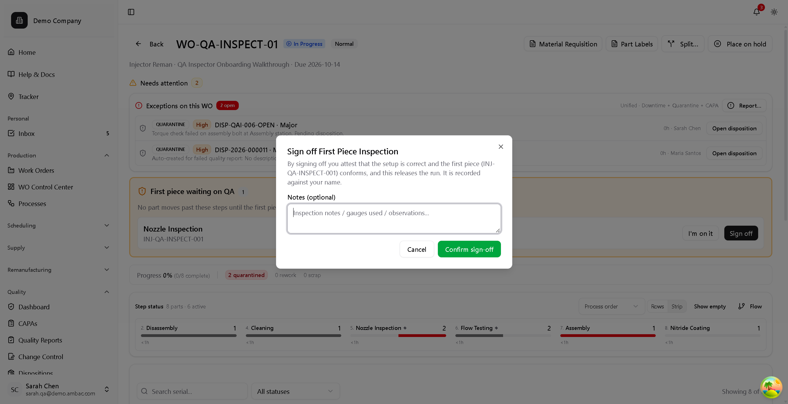

# QA Inspector Guide

This guide is for Quality Assurance Inspectors who perform inspections, record measurements, create quality reports, and manage sampling in uqmes.

!!! tip "Demo Account"
    In demo mode, log in as **Sarah Chen** (sarah.qa@demo.ambac.com) to experience the QA Inspector workflow. You'll see:

    - Parts ready for inspection: INJ-0042-018 at Final Test, INJ-0042-021 at Flow Testing
    - Quarantined parts awaiting disposition: INJ-0042-017, INJ-0042-019
    - SPC violation alert: Flow rate Rule 2 violation
    - CAPA task: "Update incoming inspection procedure" for CAPA-2024-003
    - Pending approval: APR-2024-0015 (CAPA closure)

## Your Role

As a QA Inspector, you:

- Perform inspections at quality gates
- Record measurements and inspection data
- Create quality reports (NCRs) for non-conformances
- Document defects with annotations
- Record disposition decisions

!!! note "You record decisions; you don't recommend them"
    There is no *recommend then wait* step. Choosing the disposition type **is**
    the authorized act, and the record stores who authorized it and when. If you
    don't hold the permission, an approver co-signs on your screen — see
    [Dispositions](../workflows/quality/dispositions.md#who-can-decide-and-co-signing).

!!! note "Sampling is decided for you"
    A rule flags the part and the plan is calculated — *"Inspect 29 of 250 ·
    Accept ≤ 0 · Reject ≥ 1"*. Your job is to answer **"why this part?"** from
    the Sample flag and its reason, not to choose the sample size.

## Getting Started

### First-Time Setup

1. Log in and review [Navigation Tour](../getting-started/navigation.md)
2. Familiarize yourself with Quality section
3. Understand your inspection assignments

### Your Main Pages

| Page | Location | Purpose |
|------|----------|---------|
| **Home** | Home | Your inspection queue — first pieces, incoming, OSP returns |
| **Incoming Inspection** | Supply > Incoming Inspection | Purchased lots **and** OSP returns, one queue |
| **Work Orders** | Production > Work Orders | Work order detail and history |
| **Quality Reports** | Quality > Quality Reports | NCRs you've created |
| **Dispositions** | Quality > Dispositions | Quarantined parts |
| **Inbox** | Personal > Inbox | CAPA tasks and pending approvals |
| **Heat Map** | Quality > Heat Map | Visual defect analysis |

## Daily Workflow

### 1. Check Your Queue

**Your Home page is your queue.** When you log in as a QA Inspector, Home shows
the inspection work waiting on you rather than a generic dashboard:

- **First piece waiting** — parts held until you sign off the first piece, each
  with **I'm on it** and **Start check**
- **Incoming queue**, segmented into **Receiving**, **OSP returns**, and
  **In-process**, with counts and age
- Counters for **Approvals**, **CAPA tasks**, and **My dispositions**
- **Review calibrations** for equipment coming due

Work the oldest and most urgent items first — each segment shows its age.

!!! note "Reaching the queue from elsewhere"
    If your Home shows a different landing (because you hold several roles), the
    same surface is always available at `/quality/inbox`.

### 2. Perform Inspections

For each inspection point:

1. Open the work order requiring inspection
2. Identify parts to inspect
3. Apply sampling (if applicable)
4. Perform measurements/checks
5. Record results
6. Disposition any part that fails

Parts that pass need no further action from you — once the step's requirements
are met, they advance automatically.

### 3. Document Issues

When problems are found:

1. Create quality report (part is automatically quarantined)
2. Add annotations (if 3D model available)
3. Notify appropriate parties

## Performing Inspections

### At Inspection Steps

1. Open the work order from **Production** > **Work Orders**
2. See parts waiting at the inspection step — the rule has already decided
   which ones those are
3. Inspect the parts presented to you
4. Record results

### Recording Measurements

Where you record depends on what you are inspecting.

**In-process, on parts** — measurements are substeps inside the step player.
Work the step's inspection-point substep and enter the value there; the system
evaluates it against the specification as you confirm, and writes it to a
Quality Report alongside the completion.

**Incoming lots** — receiving inspection has its own surface. Open the lot from
the receiving inspection queue and use **Record Measurements** there.

!!! note "There is no Record Measurements button on a part"
    The per-part button older instructions describe does not exist. For parts,
    the step player is the recording surface. See [Recording
    Measurements](../workflows/tracking/measurements.md).

!!! example "Demo: Flow Testing Measurement"
    At Flow Testing step, record Flow Rate @ 1000 bar. Spec: 105-135 mL/min. If you measure 142 mL/min (like INJ-0042-017), system shows FAIL and part routes to quarantine.

### Measurement Best Practices

- Use calibrated equipment only
- Verify equipment is in calibration
- Record actual values (don't round inappropriately)
- Document measurement conditions if relevant

## Sampling Inspections

### When Sampling Applies

1. The sampling rule selects the parts; they are the ones waiting at the step
2. Inspect them
3. Record results
4. The rule's accept/reject criteria decide the lot outcome

!!! note "You do not choose the sample"
    Sampling is decided for you by the rule attached to the step. Your job is
    to answer *"why this part?"* from the record — not to size or pick the
    sample.

### AQL Sampling

Based on lot size and AQL level:
- System calculates sample size
- Accept number (Ac) and Reject number (Re) shown
- If defects ≤ Ac: Accept lot
- If defects ≥ Re: Reject lot

### After Lot Decision

**If Accepted:**
- Parts move forward
- Sample results recorded

**If Rejected:**
- Options: 100% inspect, scrap, RTV
- Create quality report
- Disposition required

## Creating Quality Reports (NCRs)

### When to Create

- Any non-conformance found
- Failed measurements
- Visual defects
- Material issues
- Customer complaints

### Creating the Report

1. Select affected part(s)
2. Click **Create Quality Report**
3. Fill in required fields:

| Field | What to Enter | Required |
|-------|---------------|----------|
| **Status** | Where the report stands | **Yes — the only one** |
| **Part** | The affected part | No |
| **Process Step** | Where it was found | No |
| **Description** | Detailed explanation | No |

4. **Add each defect separately** — error type, count, location and severity
   belong to the defect, not to the report
5. Attach evidence (photos, data)
6. Submit

!!! note "There is no Immediate Action field"
    Containment and root cause belong to the CAPA raised from the report, not
    to the report itself.

### Severity Guidelines

| Severity | Use When |
|----------|----------|
| **Minor** | Cosmetic, no functional impact |
| **Major** | Out of spec, affects function |
| **Critical** | Safety risk, regulatory violation |

## Annotating Defects

If 3D models are configured:

### Adding Annotations

1. Open the work order containing the part (**Production > Work Orders**)
2. Find the part and open the annotation tool
3. Click location of defect on model
4. Fill in annotation details:
   - Error type
   - Severity
   - Description
5. Save

### Why Annotate

- Builds heat map data over time
- Visual communication of issues
- Pattern identification
- Training reference

## Managing Quarantine

### Parts You've Quarantined

1. Navigate to **Quality** > **Dispositions**
2. See parts awaiting disposition
3. Provide additional information as needed
4. Await disposition decision

### Your Role in Disposition

- Provide inspection data
- Answer questions about findings
- Verify rework completion (if assigned)

## First Piece Inspection (FPI)

On a step's first pass, one part is the **first piece**. The operator runs the
work instruction on it; you buy it off before the rest of the batch runs.

!!! important "It is a batch gate, not a per-part check"
    The work order's control page says so plainly: *"No part moves past these
    steps until the first piece is bought off."* A missing or failed FPI holds
    the whole batch.

### Where it appears

A pending FPI shows on your **Home** page as a red banner — one row per waiting
first piece, with the step, work order, part and a waiting-age timer — offering
**I'm on it** (acknowledge) and **Start check**.

### Two routes, with different options

| Route | What you get |
|-------|--------------|
| **The runtime** — work order → Start Work → tick the part → Start | **Sign off & pass · Fail · Waive** |
| **The control page** — *First piece waiting on QA* card → **Sign off** | **Sign off only** |

!!! warning "The quick route cannot fail or waive"
    The control page's **Sign off** is a shortcut to the pass outcome. If the
    first piece is **not** acceptable, go through the runtime, where Fail and
    Waive exist.

### Signing off

The dialog states what you are attesting to:

> By signing off you attest that the setup is correct and the first piece
> conforms, and this releases the run. It is recorded against your name.

Add notes — gauges used, observations — and confirm. The banner turns green and
the run is released.

!!! important "Separation of duties"
    The operator signed the inspection substeps; **you** sign the buy-off. They
    must be different people — if you had also signed the substeps, the buy-off
    is refused.

    An inspector who lacks `sign_off_fpi` is not stuck: the banner offers an
    inline co-signature for an authorized colleague, the same pattern as a
    [disposition decision](../workflows/quality/dispositions.md#who-can-decide-and-co-signing).

## Incoming Inspection

For material from suppliers:

1. Identify lot to inspect
2. Apply incoming sampling rule
3. Perform inspection
4. Record results
5. Accept or reject lot

### Rejected Incoming Material

1. Create quality report
2. Mark lot status
3. Initiate RTV if appropriate
4. Notify purchasing/quality manager

## Supporting CAPA

You may be assigned CAPA tasks:

1. Check **Personal** > **Inbox** for assigned CAPA tasks
2. Perform assigned investigation
3. Document findings
4. Complete task with evidence
5. Mark task complete

## End of Shift

### Handoff

1. Complete in-progress inspections
2. Document partial inspections
3. Note any pending items
4. Inform next shift

### Records

- Ensure all measurements saved
- Quality reports submitted
- Annotations complete

## Quick Reference

| Task | Steps |
|------|-------|
| Record measurement | On a part: step player → inspection substep → enter value → **Confirm & next** · On an incoming lot: receiving inspection → **Record Measurements** |
| Create NCR | Select part → Create Quality Report → Fill form → Submit |
| Add annotation | Heat Map → Click location → Enter details → Save |
| Buy off a first piece | Home red banner → **Start check** → review captures → **Sign off & pass** (or Fail / Waive) |
| Accept lot | Complete sampling → Record results → System calculates |

## What You CAN'T Do

Typically you cannot:

- Approve dispositions (QA Manager)
- Close CAPAs (QA Manager)
- Manage users (Tenant Admin)
- Classify documents, or read the Secret tier (QA Manager classifies; Document
  Controller and Tenant Admin read Secret)

Escalate to QA Manager as needed.

!!! note "You can do more than you might expect"
    The shared staff base is broad: a QA Inspector **can** create orders and work
    orders, upload documents, and move parts. Whether you *should* is your shop's
    procedure, not a permission.

## Troubleshooting

### Measurement equipment shows expired

- Don't use that equipment
- Select different calibrated equipment
- Report to calibration manager

### Can't find part to inspect

- Check filters
- Verify work order assignment
- Part may be at different step

### Quality report won't submit

- Check required fields
- Ensure parts are selected
- Verify you have permission

## Related Documentation

- [Quality Reports](../workflows/quality/quality-reports.md)
- [Recording Measurements](../workflows/tracking/measurements.md)
- [Sampling Rules](../workflows/quality/sampling.md)
- [Creating Annotations](../3d-models/annotations.md)
- [Heat Maps](../analysis/heatmaps.md)
