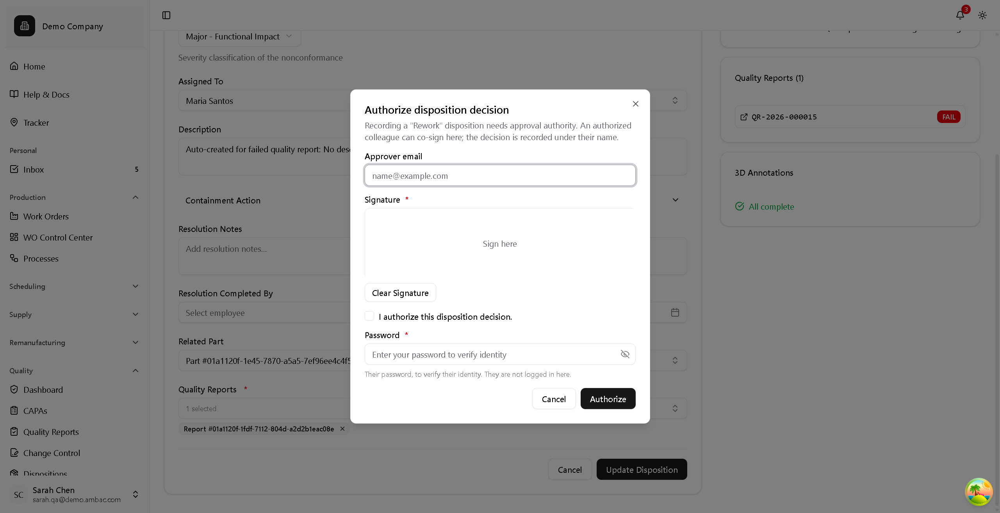

# Dispositions

A **disposition** is the recorded decision about what happens to nonconforming
product. It is the controlled act at the centre of ISO 9001 **8.7** and AS9100 —
the record has to say what was decided, on what authority, and why.

**Quality** > **Dispositions**

Dispositions also surface where the nonconformance was found: the work order
**control** page lists open ones under *Exceptions on this WO*, each with an
**Open disposition** button.

## Where a disposition comes from

A failure opens one by itself: a reading out of spec, an inspector's FAIL, a
report edited to FAIL, a failed first piece. Its description says what failed,
for example *"Failed Nozzle Inspection: Hole blockage"*, or the report's own
description when it has one.

It opens **unassigned**. Nobody is picked for it; it waits on the QA home page,
under *Unassigned dispositions*, until someone presses **Take it** (which needs
`change_quarantinedisposition`). It then moves to their **My dispositions**. The part stays
quarantined until the disposition acts on it: no one can start it in the
meantime.

## The decisions

Choosing between these is the judgement the system asks you to make. They are
not interchangeable, and the standard treats them very differently.

| Decision | Use when | Part becomes |
|----------|----------|--------------|
| **Rework** | The part can be brought back to **full** conformance | `REWORK_NEEDED` |
| **Repair** | The part can be made acceptable but will **still deviate** from spec | `REWORK_NEEDED` |
| **Scrap** | The part cannot be used or economically corrected | `SCRAPPED` |
| **Use As Is** | The nonconformance is real but the part is acceptable **as it stands** | `IN_PROGRESS` — back at work on its step |
| **Return to Supplier** | The supplier is responsible; return for credit or replacement | `CANCELLED` |

!!! info "Use As Is returns the part to work, not to the next step"
    A use-as-is part goes back to **In progress** — it is at the step it was
    always at, and the operator completes that step as usual. The disposition
    is a documented decision, not a routing action.

    It does **not** become Ready for next step. That status means something
    specific and different: a unit waiting for the rest of its batch. A
    use-as-is part carrying it read as batch-staged on every queue and
    dispatch list until somebody completed the step.

!!! info "Rework vs Repair is the distinction auditors check"
    **Rework** restores full conformance — afterwards the part meets the
    drawing, and nothing is given up. **Repair** leaves a known, accepted
    deviation. They look similar on the floor and are entirely different
    records: repair is a concession against the design, rework is not.

    Choosing *Repair* when you mean *Rework* creates a deviation record against
    a part that doesn't have one. Choosing *Rework* when you mean *Repair*
    hides one that does.

Rework and Repair both increment the part's **rework count**.

### When the finding was wrong: Not a nonconformance

A disposition opened by an inspection result that was itself a mistake (a FAIL
that should have been a PASS) is closed with a sixth decision, **Not a
nonconformance (result voided)**. It is accepted only when the finding has really
been withdrawn:

1. The failing capture has been **voided**, with its reason, so its report is
   superseded and kept, not deleted.
2. The part has been **re-inspected** and the new result is a **PASS**. The good
   result is on record before the finding is written off.
3. The person deciding is **neither** the inspector who recorded the failure nor
   the one who voided it. An inspector doesn't clear their own finding.

No approval reference, containment or annotation is asked for, because there was
no nonconforming product. The decision's note records the void reason. The part
then completes its step as usual.

Until the re-inspection is on record, it is refused: *"Re-inspect first: the voided
result hasn't been captured again with a PASS."*

## Use As Is and Repair require recorded approval

These two accept known-nonconforming product, so they carry the highest
authority burden. The system **will not record the decision without an approval
reference**:

> *A 'Use As Is' decision accepts nonconforming product and requires recorded
> customer/design approval — provide an approval reference.*

This is a hard stop, not a warning. Obtain the concession or deviation through
your normal customer/engineering channel first, then enter its reference. If the
departure is known **before** the work, raise a [temporary
change](../change-control/overview.md#temporary-changes-deviations) instead, so
the parts are made to the agreed spec and never become nonconforming. The
reference, the date, and who authorized the decision are all stored on the
record.

Scrap, Rework, and Return to Supplier need no approval reference.

!!! warning "There is no scrap value threshold"
    Scrap does not trigger an approval step based on part value. If your
    procedure requires one, it is a procedural control, not a system-enforced
    one.

## Who can decide, and co-signing

Recording a decision requires **`approve_disposition`**.

If you don't hold it, you don't have to hand the record off: an authorized
approver can **co-sign inline**. Choose the disposition type and press **Update
Disposition** as normal — the editor will not commit, and instead opens
**Authorize disposition decision**:



It asks for the approver's **email**, their **signature**, an explicit *"I
authorize this disposition decision"* tick, and their **password** — captioned
*"Their password, to verify their identity. They are not logged in here."*

!!! important "This is a co-signature, not a login switch"
    The approver never logs in. They authenticate on **your** screen, the
    decision commits, and the record carries **their** name as the authority with
    you as the caller.

The disposition type is changed only through this decision. An edit to the record
that tries to change the type is refused: *"The disposition is decided through
Decide, which records who authorized it (a co-signer can authorize) — it can't be
changed by editing the record."*

    Trainees routinely read this dialog as an error. It isn't — it is the gate
    doing its job, and it is how a routine decision keeps moving without
    misattributing who authorised it.

Either way the record stores **who authorized it and when** — that pair is what
8.7 asks for.

!!! tip "Closing is yours even when the decision wasn't"
    Authoring the decision and **closing** the disposition are different
    permissions on the same record. An inspector who needed a co-signature for
    the decision can still close it once the work is done and re-inspected.

## Severity

| Severity | Meaning |
|----------|---------|
| **Critical** | Safety or regulatory impact; needs special handling |
| **Major** | Affects function, correctable (the default) |
| **Minor** | Cosmetic, no functional impact |

!!! note "Annotation severity is a different scale"
    A marker on the part's 3D model carries its own severity, Low to Critical.
    It rates that one finding where it sits on the part. The disposition's
    severity rates the nonconformance the findings add up to, so the two
    needn't match.

## Containment comes first

Before the disposition decision, record the **containment action** — the
immediate step taken to stop nonconforming product escaping: parts pulled to
quarantine, a machine stopped, a lot put on hold.

Containment is time-stamped with who completed it. It is deliberately separate
from the decision, because containment is urgent and the decision often is not.
An auditor reading the record wants to see the gap between *found* and
*contained* be short, regardless of how long the disposition took.

### Attaching evidence

Containment usually has evidence behind it — a photo of the segregated bin, a
signed hold tag, the tooling report that prompted the stop. Documents can be
attached to the disposition, under **Containment Action** on its edit page.

Attach the evidence rather than describing it. "Parts moved to quarantine cage"
is an assertion; the same sentence with a photo and a timestamp is a record.

## States

```
OPEN  ──(decision recorded)──▶  IN_PROGRESS  ──(resolution completed)──▶  CLOSED
```

- **Open** — raised, not yet decided. A disposition can sit here untriaged with
  no type set at all.
- **In Progress** — a decision has been recorded and is being implemented.
  Setting the disposition type is what moves it here.
- **Closed** — the resolution is complete.

### Decided wrong, or closed too soon

**While it is open,** a decision can be changed by deciding again, with the same
authority as the first. Changing a **Scrap** to anything else asks for a reason,
and brings the part back out of scrap to be handled under the new decision. Both
decisions and the reason stay in the resolution notes. A scrapped **core** is the
exception: it is reinstated from its core page, not here.

**Once closed,** its decision can't be changed by editing: *"This disposition is
closed; its decision can no longer be changed."* A disposition closed by mistake
is **reopened** instead. **Reopen** on its page, with a required reason, held by
whoever can decide dispositions (`approve_disposition`). It goes back to **In
Progress**, where it can be decided again or closed again. The decision stands
until then, so a scrapped part stays scrapped unless the disposition is decided
again. The reopen and its reason are added to the resolution notes.

## What the decision does to the part

Recording the type cascades to the part's status using the table above — but
with two guards that are worth understanding, because they explain cases where
the part *doesn't* move.

**A disposition is a documented decision, not a routing action.**

**Rework and Repair only route a part that is still held** — quarantined, or
not yet started. If the operator has already routed the part onward (in
progress at a step, awaiting QA, already in rework), the disposition is recorded
as a **paper record** of what was authorized and the part's status is left
alone. It would otherwise drag a part that has moved on backwards.

**A less severe decision cannot undo a terminal one.** Scrap dominates
everything; a Rework, Repair, or Use As Is decision on *another* disposition
cannot revive a part that is already scrapped or cancelled. The one way back is
the disposition that scrapped it being decided again while it is open, with a
reason — see [Decided wrong, or closed too
soon](#decided-wrong-or-closed-too-soon). Reversing a terminal status is never a
side effect.

## Scrap verification

Scrapped parts carry their own verification fields: whether scrap was verified,
**by what method**, by whom, and when. Recording the method matters — "rendered
unusable and placed in the scrap bin" is a different assurance from "witnessed
into the crusher", and for critical parts the difference is the whole point of
the control.

This is what prevents scrapped product re-entering the supply chain, and it is
routinely sampled in audits.

## Closing a disposition

Completing the resolution closes the record — but only once nothing is
outstanding against it. If blockers remain, the close is rejected and names
everything in the way in one message. Clear those first.

!!! info "Some defects must be marked on the 3D model"
    When a report carries a defect type that needs a 3D annotation, the
    disposition shows **3D Annotations Required** and can't close until the
    defect is marked. **Go to Annotator** opens the annotator with that report
    already selected. Every annotation belongs to a quality report, so each
    marker on the model traces back to the inspection that found it.

!!! warning "Critical and Major need containment recorded first"
    A disposition of **Critical** or **Major** severity cannot be closed until a
    **containment action** is recorded on it. That is the commonest blocker and
    the one most often missed, because containment is captured in a different
    place from the decision — see [Containment comes first](#containment-comes-first)
    above.

## Permissions

| Permission | Allows | Held by |
|------------|--------|---------|
| `view_quarantinedisposition` | View disposition records | Every staff role |
| `add_quarantinedisposition` | Raise a disposition | Every staff role |
| `approve_disposition` | **Record the decision**, or co-sign someone else's | QA Manager, Tenant Admin |
| `close_disposition` | **Close it** once the resolution is done | QA Inspector, Shift Lead, Production Manager, QA Manager, Tenant Admin |

*Held by* is the groups that hold it when an organisation is created. Group permissions can be changed, so check your own in [Roles & Groups](../../admin/users/roles.md).

Raising, deciding and closing are three different permissions, and they are
deliberately not held by the same set of people:

- **Raising** is open — anyone who finds a problem can start the record.
- **Deciding** is narrow. Accepting or scrapping nonconforming product is
  material review authority, which is a quality function under AS9100. The
  Production Manager does **not** hold it.
- **Closing** is broad again, because many roles legitimately finish the work on
  the floor. The line Operator is still excluded: they surface the problem, they
  don't disposition it.

So the person who authorizes a record needn't be the one who raised it, and the
person who closes it needn't be either.

## Next Steps

- [Quarantine](quarantine.md) - Managing held parts
- [Quality Reports](quality-reports.md) - Creating NCRs
- [CAPA Overview](../capa/overview.md) - When a pattern needs root-cause work
